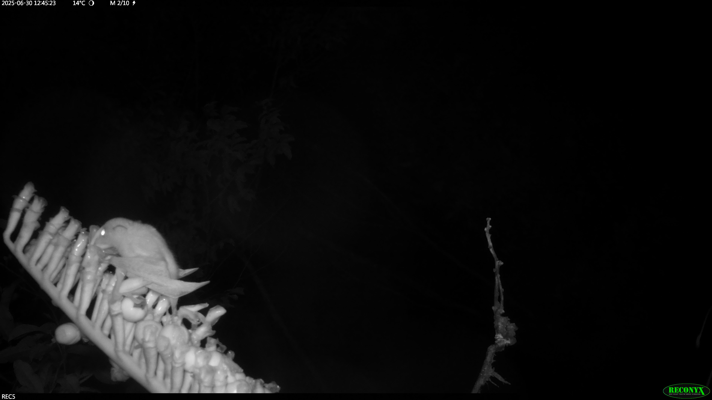

  <h1>Welcome!</h1>

  

    PhD Student | Plant Systematics &amp; Evolution
  

  

    University of British Columbia
  

  

    I am interested in understanding the diversity,
    systematics, and evolution of tropical plants,
    with a particular focus on the ginger family
    (Zingiberaceae).
  

  

    My research uses molecular phylogenetics and
    phylogenomics to resolve evolutionary relationships
    and investigate patterns of diversification in
    tropical plant lineages. I am also interested in
    pollination biology and the diversity and evolution
    of sexual systems in Zingiberaceae.
  

  

    Through my research, I aim to contribute to a better
    understanding of tropical plant diversity and its
    evolutionary history.
  

  <a class="home-link"
     href="{{ '/about.html' | relative_url }}">
    More about me &rarr;
  </a>

<h2>Research Interests</h2>

<a href="/research.html#systematics">

<h3>Systematics of Ginger</h3>
</a>

<a href="/research.html#trait-evolution">

<h3>Trait Diversity &amp; Evolution</h3>
</a>

  

    <a class="home-link"
       href="{{ '/research.html' | relative_url }}">
      Explore my research &rarr;
    </a>

  

