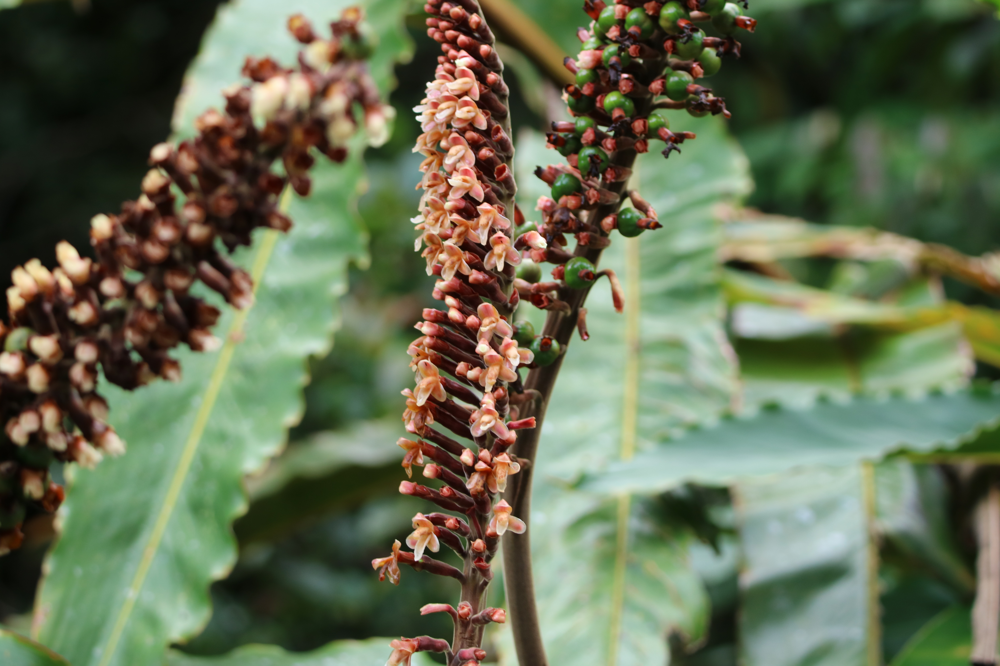
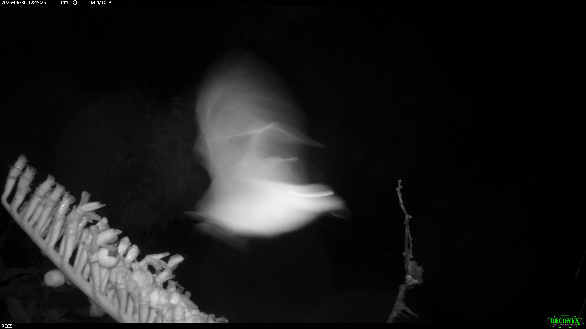

[Home](/) • [About](/about) • [Research](/research) • [Publications](/publications) • [Contact](/contact)

  <h2>Phylogenetics of Zingiberaceae</h2>
  

    
    
    
    
  

  

    

      My research investigates evolutionary relationships within the ginger family
      (<em>Zingiberaceae</em>), particularly the genus _Hellwigia_, using DNA marker data and phylogenomic datasets. The goal is to provide a robust phylogenetic framework that can serve as a foundation for taxonomic revision and for analyzing trait evolution within the group. 
    

  

  

    <strong>Relevant publications:</strong>
    <ul>
      <li>Senjaya SK, Poulsen AD, Ardiyani M, Cronk QCB. 2025. Reinstatement of Hellwigia Warb. (Zingiberaceae) and its molecular and morphological delimitation. PhytoKeys 261: 233–273.</li>
    </ul>
  

  <h2>Sexual System Diversity and Evolution</h2>
  
  

    

      My work explores the diversity and evolution of sexual systems in
      <em>Zingiberaceae</em>. I combine phylogenetic analyses with population-level
      data on gender expression to better understand how reproductive systems evolve
      in this group.
    

  

  

    <strong>Relevant publications:</strong>
    <ul>
      <li>paper 1</li>
    </ul>
  

  <h2>Pollination Biology</h2>
  
  

    

      My current work focuses on gathering empirical data on pollination systems
      in <em>Zingiberaceae</em> to identify pollination syndromes within the group
      and to better understand how pollination influences reproductive strategies
      and diversification.
    

  

  

    <strong>Relevant publications:</strong>
    <ul>
      <li>paper 1</li>
    </ul>
  

